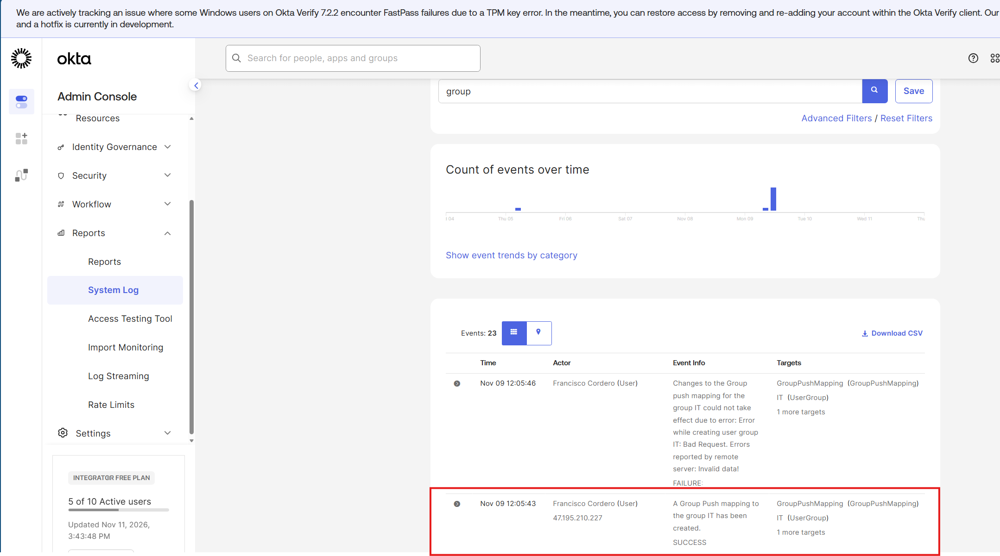
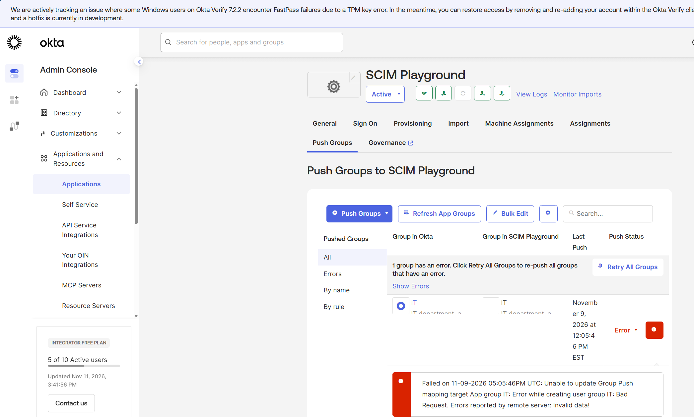
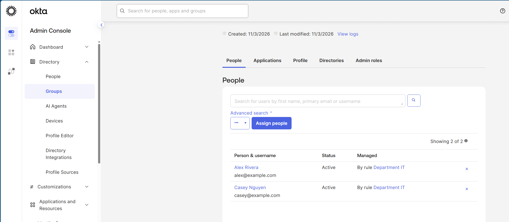
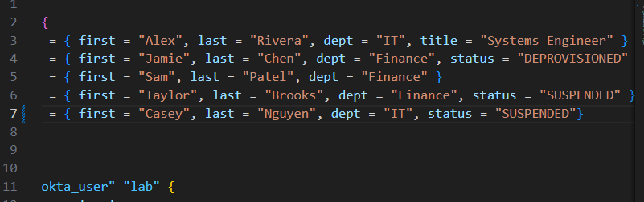
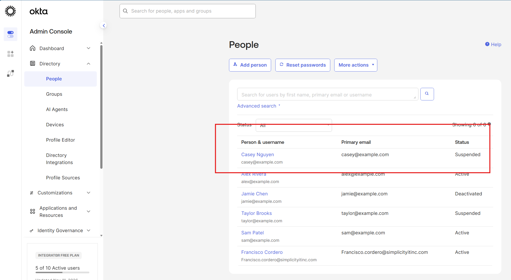
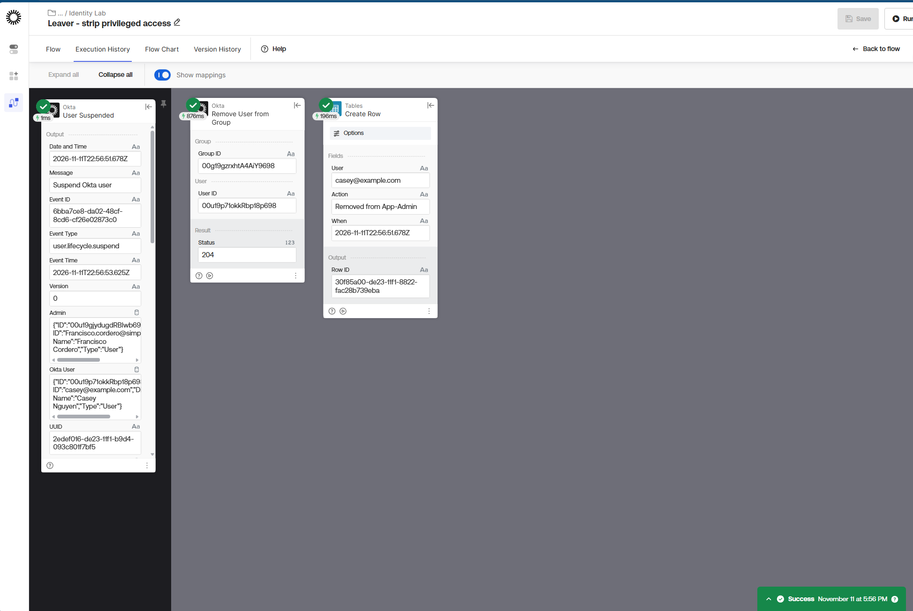
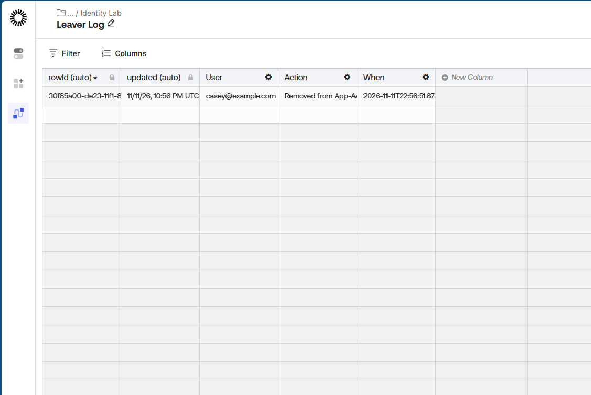
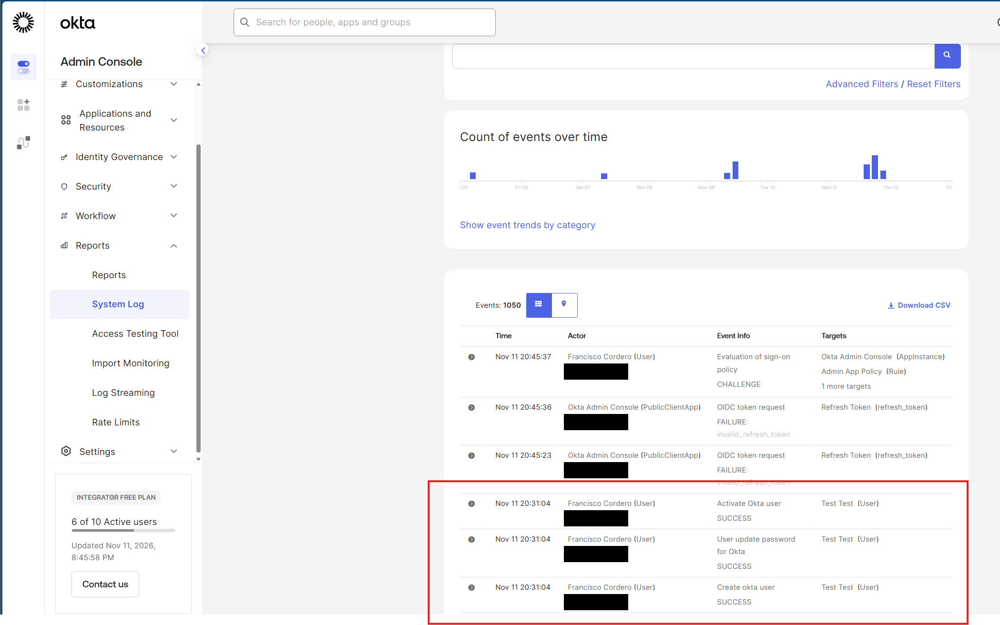
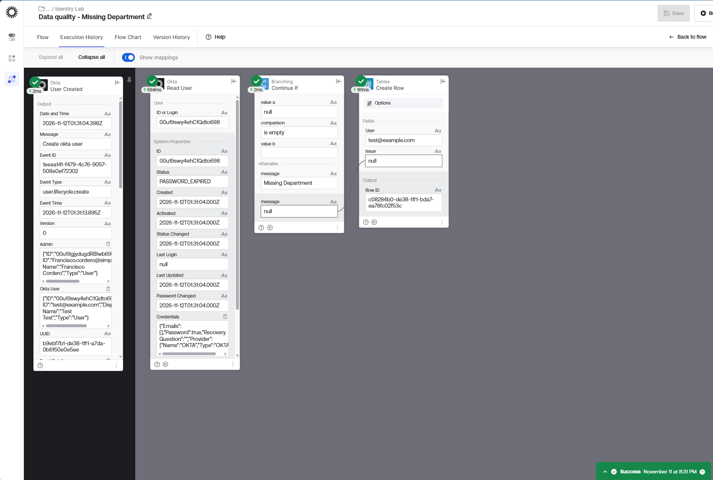
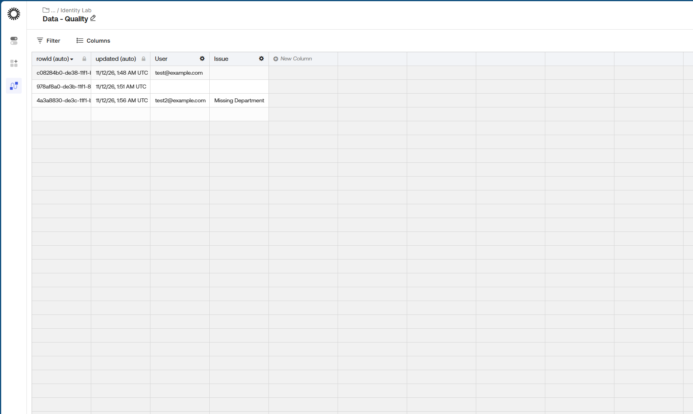

# Okta Identity as Code

An Okta tenant managed with Terraform, with SCIM provisioning, Okta Workflows
automation, a Python access report and GitHub Actions checks on every change.

## What it demonstrates
- Joiner, mover, leaver: department-based group rules, and suspension in code
- Least privilege: the admin group is granted explicitly, never by rule
- OIDC app integration with group-based assignment
- MFA required for privileged users through an app sign-on policy
- Stale-account reporting through the Okta Users API (Python)
- Change control: pull requests, branch protection and automated checks
- SCIM 2.0 provisioning from Okta to a downstream app, with Group Push
- Okta Workflows automations: privileged access removed on suspension, and new users missing a department flagged

## How it's organized
- `terraform/` - users, groups, group rules, the OIDC app and its sign-on policy, and the SCIM app assignments
- `scripts/` - Python report of users inactive for 30+ days, and a SCIM reconciliation script (see the note in Lab 5)
- `workflows/` - the Okta Workflows folder export (both flows and their tables)
- `.github/workflows/` - format, validate and syntax checks on every pull request

## How to run it
1. Set `OKTA_ORG_NAME`, `OKTA_BASE_URL` and `OKTA_API_TOKEN`, plus `TF_VAR_test_password`
2. `cd terraform`, then `terraform init` and `terraform apply`
3. `python scripts/inactive_users.py 30`

## Screenshots

### Joiner: group rule adds IT users automatically

### Mover: one attribute change moves the user between groups

### Leaver: suspension in code

### MFA sign-in through the OIDC app

### Unassigned users are refused

### Inactive-user report

### Change control: a failed check blocks the merge

### Change control: a passing check allows the merge

## Lab 5: SCIM provisioning and Workflows

The Okta org provisions users to a SCIM 2.0 test app ([scim.dev](https://scim.dev)), and two Okta Workflows flows automate leaver and data-quality checks. The flows are exported to [`workflows/identityLab.folder`](workflows/identityLab.folder), so they can be reviewed and re-imported.

### SCIM Group Push

Group Push sends an Okta group, and its members, to the downstream app. Okta created the push mapping for the IT group:

The SCIM test target then rejected the group itself with `Bad Request: Invalid data`. Okta flags the failed push, records the reason the remote server gave, and offers **Retry All Groups**, which is where you'd start troubleshooting a real app:

The IT group being pushed is filled by a group rule, not by hand, so Alex and Casey are members because their department is IT:

### Leaver: privileged access removed on suspension

The leaver decision is made in code: Casey's status is set to `SUSPENDED` in `users.tf`, and `terraform apply` suspends the account:

The **Leaver - strip privileged access** flow fires on Okta's User Suspended event. It removes the user from App-Admins (Okta returned `204`) and writes a row to a log table:

**The drift lesson.** After the flow ran, `terraform plan` wanted to add Casey back to App-Admins, because the code still listed Casey there. Two systems were managing the same group and disagreed. The fix was to decide who owns the object: the leaver decision had been made, so the code now lists only Alex, and `terraform plan` reports no changes.

### Data quality: new users with no department

Group rules and SCIM depend on `department`, so a user created without one gets no access. To test the **Data quality - Missing Department** flow, a test user was created with no department:

The flow reads the new user's full profile, continues only if Department is empty, and logs the user. This first test run logged a blank Issue. Mapping Issue to the Continue If message fixed it for later runs:

### SCIM reconciliation

`scripts/scim_reconcile.py` compares the Okta app's assignments with the app's own SCIM user list, to find orphans (accounts in the app that Okta doesn't own) and missing accounts. It needs a SCIM target that keeps data. scim.dev's free plan doesn't, so the script hasn't been run against real provisioned data yet.

## What I'd do in production
- An OAuth service app with scoped permissions instead of an API token
- Remote state with locking (for example, Terraform Cloud)
- The HR system as the source of truth for the department attribute
- SCIM to a real app (Slack, Zoom, GitHub Enterprise) with OAuth instead of a static bearer token
- Workflows with error handling and a Continue If check before removing group membership
- A scheduled reconciliation that alerts on new orphans
