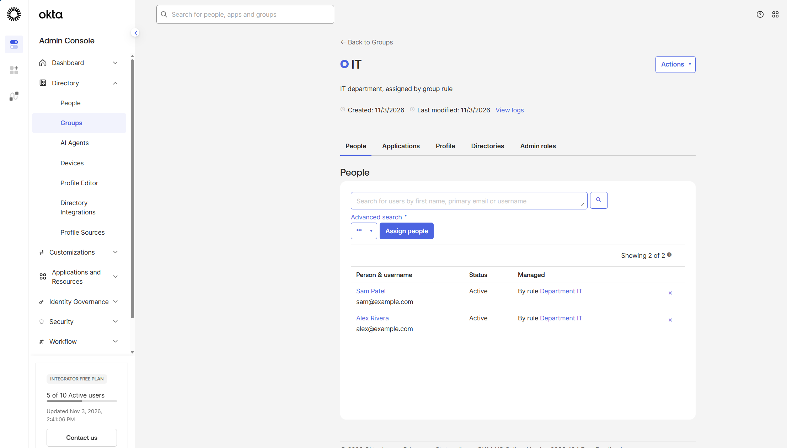
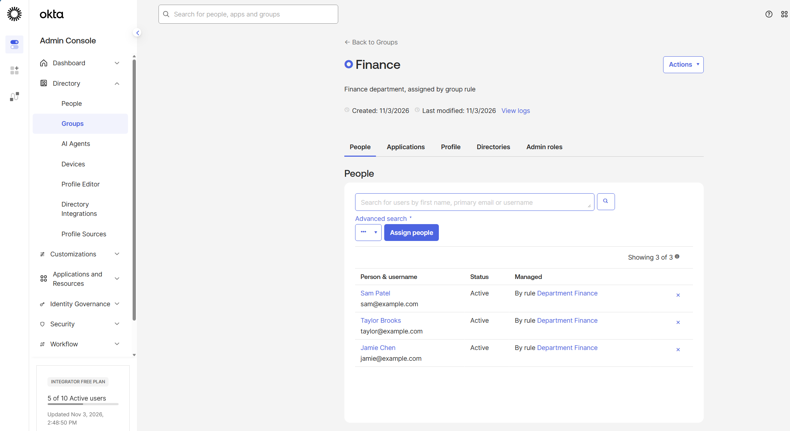
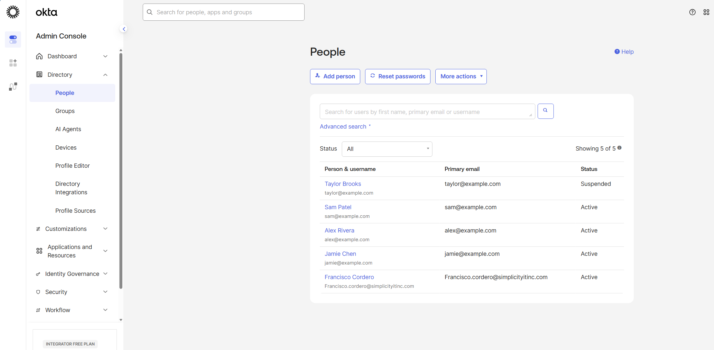
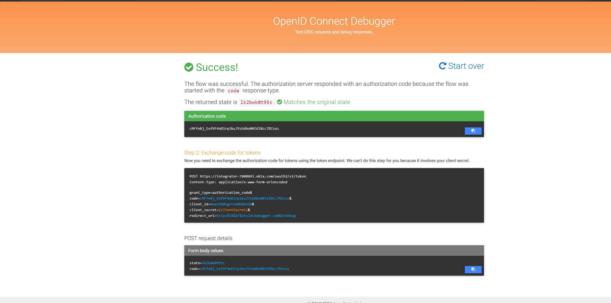
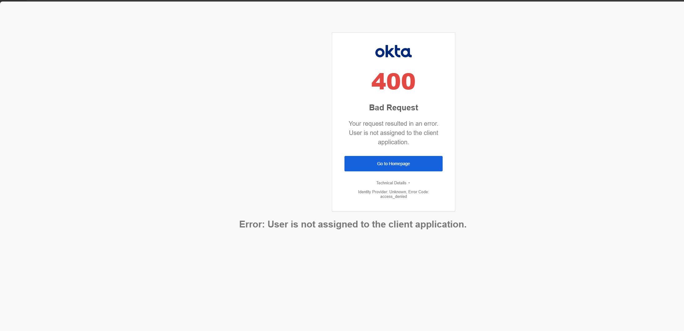
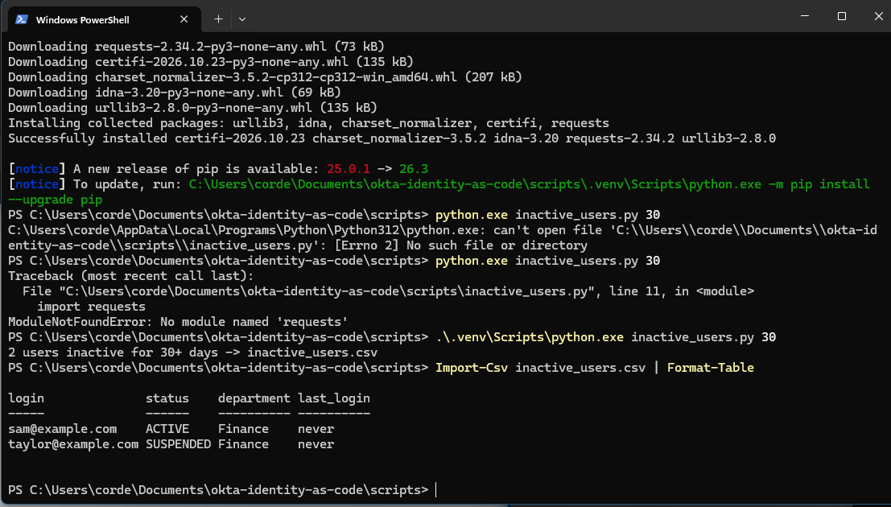
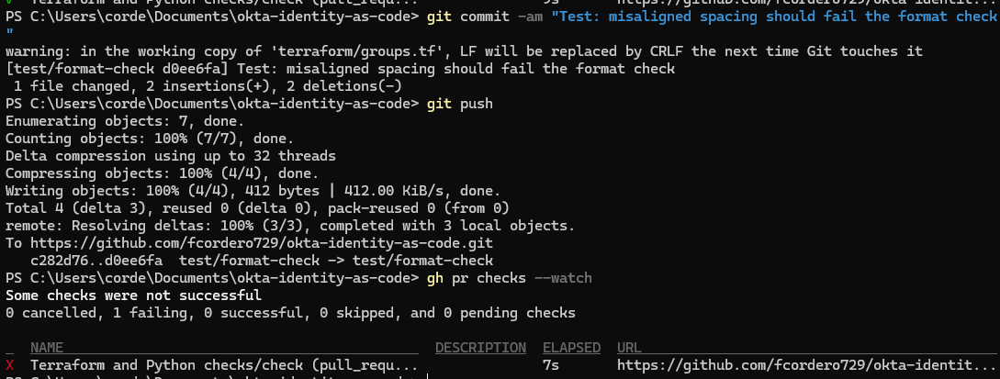
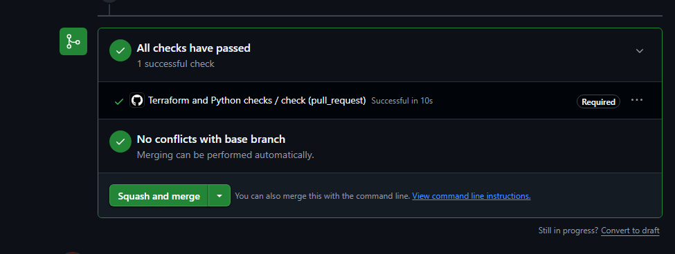

# Okta Identity as Code

An Okta tenant managed entirely with Terraform, with a Python access report
and GitHub Actions checks on every change.

## What it demonstrates
- Joiner, mover, leaver: department-based group rules, and suspension in code
- Least privilege: the admin group is granted explicitly, never by rule
- OIDC app integration with group-based assignment
- MFA required for privileged users through an app sign-on policy
- Stale-account reporting through the Okta Users API (Python)
- Change control: pull requests, branch protection and automated checks

## How it's organized
- `terraform/` - users, groups, group rules, the OIDC app and its sign-on policy
- `scripts/` - Python report of users inactive for 30+ days
- `.github/workflows/` - format, validate and syntax checks on every pull request

## How to run it
1. Set `OKTA_ORG_NAME`, `OKTA_BASE_URL` and `OKTA_API_TOKEN`, plus `TF_VAR_test_password`
2. `cd terraform`, then `terraform init` and `terraform apply`
3. `python scripts/inactive_users.py 30`

## Screenshots

### Joiner: group rule adds IT users automatically

### Mover: one attribute change moves the user between groups

### Leaver: suspension in code

### MFA sign-in through the OIDC app

### Unassigned users are refused

### Inactive-user report

### Change control: a failed check blocks the merge

### Change control: a passing check allows the merge

## What I'd do in production
- An OAuth service app with scoped permissions instead of an API token
- Remote state with locking (for example, Terraform Cloud)
- The HR system as the source of truth for the department attribute
